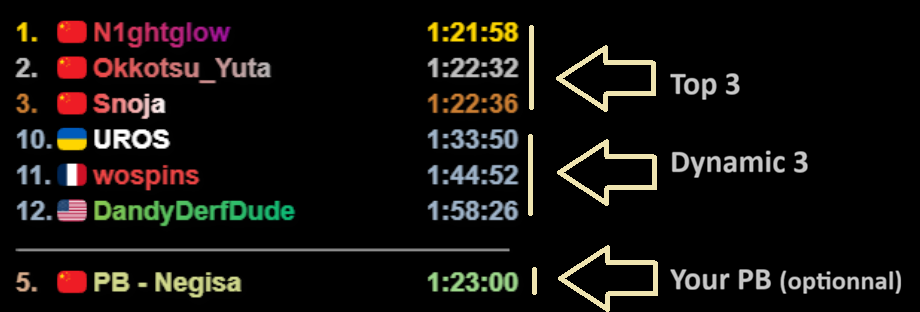

# Speedrun Leaderboard Overlay

Current version: **v2.0**

An animated [speedrun.com](https://www.speedrun.com/) and [Team Hitless](https://www.teamhitless.com/hitless-speedrun-games/) leaderboard overlay for OBS, with a multilingual PowerShell configuration manager.



[View an animated example](https://github.com/user-attachments/assets/747b4867-09ce-4679-a8de-b95bb4d2693e)

## Main features

- Live speedrun.com leaderboard data with automatic refresh.
- Team Hitless leaderboards for hitless runs, selectable per preset.
- Accurate temporary PB ranking against the complete category leaderboard.
- Multiple game and category presets.
- English, French, Spanish, Portuguese, and Chinese interfaces.
- Animated carousel, flags, trophy icons, recent-run highlighting, and custom PB styles.
- Configurable dimensions, fonts, spacing, colors, timings, and displayed runs.
- Resilient refreshes that keep the last valid leaderboard visible.
- Validated configuration saves with an automatic `config.json.backup`.

## Installation

### Requirements

- Windows 10 or 11.
- [PowerShell 7](https://github.com/PowerShell/PowerShell/releases/latest).
- OBS Studio with a Browser Source.

### Setup

1. Download or clone this repository.
2. Double-click `FIX_ACCESS.bat`.
3. Choose a language in the configuration manager.
4. Add a preset: choose speedrun.com or Team Hitless, then select the game and category.
5. Set your speedrun.com player name and country if you want temporary PB tracking.

You can also start the manager manually:

```powershell
pwsh -NoProfile -ExecutionPolicy Bypass -File .\configure.ps1
```

`FIX_ACCESS.bat` uses a process-scoped execution-policy override. It does not change your account-wide PowerShell policy.

## OBS setup

1. Add a **Browser Source**.
2. Enable **Local file** and select `leaderboard.html`.
3. Set the Browser Source width and height to the values configured in the Visual Tweaks menu.

The overlay reloads its configuration and leaderboard data automatically, so the OBS source normally does not need to be refreshed.

## Configuration

Use `configure.ps1` for normal configuration:

- Add, rename, select, or remove presets.
- Set the player name, country, and temporary PB.
- Change the interface language.
- Customize the overlay through **Visual Tweaks**.
- Reset an invalid configuration safely.

Settings are stored in `config.json`. The main display options are under `defaults`:

| Setting | Purpose |
| --- | --- |
| `topCount` | Positions that always remain visible |
| `maxRuns` | Maximum runs displayed by the carousel |
| `runsPerBatch` | Entries shown on each carousel page |
| `refreshInterval` | Data refresh interval in seconds; `0` disables it |
| `displayWidth`, `displayHeight` | OBS Browser Source dimensions |
| `timeFormat` | Standard or unit-based time display |
| `pbColor`, `pbUseRainbow` | Temporary PB appearance |
| `fontStyle`, `fontSize` | Leaderboard typography |
| `categoryNameVisible` | Shows or hides the category title |

`maxRuns` only limits displayed entries. When a temporary PB is active, its rank is calculated against the complete speedrun.com category rather than the displayed subset.

For manual editing, start from [`config.example.json`](config.example.json). Invalid values are normalized when the manager saves the configuration.

## Team Hitless leaderboards

When adding a preset, choose **Team Hitless** to display a leaderboard from [teamhitless.com](https://www.teamhitless.com/hitless-speedrun-games/) instead of speedrun.com. The manager lists the games that have a hitless leaderboard, then every leaderboard on the game's page, with its run count and world record.

- Data is read from the public Team Hitless pages and refreshed at most every 5 minutes, since the site is updated by hand.
- Team Hitless does not publish countries, submission dates, or trophies: those rows show the default globe and no trophy icon.
- The temporary PB works the same way: its rank is calculated against the whole Team Hitless leaderboard. Set your player name exactly as it appears on Team Hitless.
- A Team Hitless preset is stored with `"source": "teamhitless"` and a `teamHitless` object (page slug, section, title, and table position). Presets without `source` keep using speedrun.com.

## Temporary PB

1. Configure your speedrun.com player name and country.
2. Open **My Temporary PB** in `configure.ps1`.
3. Enter a time such as `1:23.45`, `32:32`, or `1:25:31.255`.
4. Keep the PB active to show it in the dedicated bottom row.

The PB receives the rank it would have on speedrun.com, including when that rank is outside `maxRuns`.

## Flag overrides

Country flags use ISO 3166-1 alpha-2 codes. To replace a flag, add a mapping to `flagOverrides`:

```json
{
  "flagOverrides": {
    "HR": "FR"
  }
}
```

## Troubleshooting

- **The script does not start:** run `FIX_ACCESS.bat`, or use the manual PowerShell command above.
- **A manual edit broke the configuration:** replace `config.json` with `config.json.backup`, then reopen the manager.
- **A custom PB color is ignored:** disable `pbUseRainbow`.
- **Carousel rows are missing:** increase the OBS source height or reduce category spacing and rows per batch.
- **Flags or leaderboard data do not load:** verify the internet connection and speedrun.com availability.
- **A game or category is missing:** reopen the preset wizard and verify its name on speedrun.com.
- **A Team Hitless leaderboard no longer loads:** the page layout may have changed on teamhitless.com. The overlay keeps the last valid leaderboard; re-add the preset to pick the leaderboard again.

## Quick-start guides

- [English](QUICK_START_EN.md)
- [Français](QUICK_START_FR.md)
- [Español](QUICK_START_ES.md)
- [Português](QUICK_START_PT.md)
- [中文](QUICK_START_ZH.md)

## Project files

```text
configure.ps1       PowerShell configuration manager
leaderboard.html    OBS leaderboard overlay
config.json         Personal configuration, created locally
config.example.json Example configuration
config.json.backup  Automatic recovery copy
FIX_ACCESS.bat      Safe PowerShell launcher
```

The distributed application intentionally remains one PowerShell manager and one HTML overlay.

## Validation

Run the built-in checks after modifying the project:

```powershell
pwsh -NoProfile -ExecutionPolicy Bypass -File .\configure.ps1 -Validate
```

The validation checks configuration defaults, schema normalization, translations, time parsing, Team Hitless table parsing, and required overlay features.
